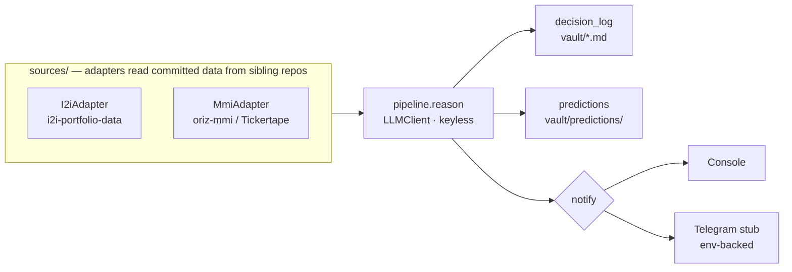

# oriz-brain — ChiragOS ambient personal-AI orchestrator

> A thin ambient personal-AI orchestrator that **imports** existing fleet pieces — never rewrites them. Ingest → store → reason → decide → notify.

[](LICENSE)
[](https://github.com/chirag127/oriz-brain/stargazers)
[](https://github.com/chirag127/oriz-brain/commits)
[](https://www.python.org/)

**Repo:** <https://github.com/chirag127/oriz-brain> · **Landing:** <https://chirag127.github.io/oriz-brain/>

oriz-brain is a thin ambient-brain that runs a single reasoning cycle over data your other fleet repos already commit — P2P portfolio JSON, market sentiment, and more. It **imports** those pieces (agent-forge for reasoning, sibling repos for data) rather than duplicating them, writes an append-only markdown decision log, tracks its own predictions for calibration, and notifies you when something matters.

Keyless LLM (kilo.ai → pollinations failover), git-friendly markdown storage under `vault/`, no extra services to run.

⭐ If this is useful, please [star the repo](https://github.com/chirag127/oriz-brain/stargazers) — it helps others find it.

## How it works



## Architecture — import, don't rewrite

```
oriz_brain/
├── sources/            # pluggable adapters that READ existing repos' committed data
│   ├── i2i.py          # → repos/own/i2i-portfolio-data/raw/api/  (P2P portfolio JSON)
│   └── mmi.py          # → repos/own/oriz-mmi committed state OR keyless Tickertape API
├── pipeline.py         # reason() calls LLMClient (same kilo→pollinations chain as agent-forge)
├── llm.py              # keyless LLMClient (kilo.ai → pollinations failover)
├── decision_log.py     # append-only markdown vault/ (git-friendly, no extra service needed)
├── predictions.py      # prediction tracker + calibration scoring
├── notify/             # ConsoleNotifier (default) + TelegramNotifier stub (env-backed)
└── cli.py              # brain run | brain log | brain sources | brain predict | brain score
```

### Repos consolidated (imported, not copied or deleted)

| Repo | Role in oriz-brain | How |
|---|---|---|
| `agent-forge` | Reasoning engine (Planner→Executor→Critic Orchestrator) | pip dep `agent-forge @ git+…`; LLMClient mirrors its provider chain |
| `i2i-portfolio-data` | P2P portfolio data source | `I2iAdapter` reads `raw/api/escrow-overview.json` + `emi-status-overview.json` |
| `oriz-mmi` / `mmi-tickertape` | Market sentiment source | `MmiAdapter` reads committed `data/latest.json`, falls back to keyless `api.tickertape.in/mmi/now` |
| `oz-ai` | LLM provider reference | `LLMClient` uses same kilo.ai→pollinations failover pattern (`@chirag127/oz-ai` docs it) |
| `life-cli` | Future email/reminder ingest (stub slot in sources/) | Not yet wired — add `LifeCliAdapter` when life-cli exposes a Python interface |
| `oriz-ipo` | Future IPO GMP ingest (stub slot) | Add `IpoAdapter` reading oriz-ipo's committed JSON when available |

**Nothing was copied. Nothing was deleted. Each source repo keeps its own automations running.**

## Features

- **Import-first architecture** — reuses fleet reasoning + data instead of rewriting.
- **Keyless LLM** — kilo.ai → pollinations failover, degrades gracefully to `[LLM unavailable]`.
- **Append-only decision log** — git-friendly markdown, one file per day.
- **Prediction tracker** — record predictions, resolve them, get calibration stats (Brier, over/under-confidence).
- **Pluggable sources** — adapters read committed data from sibling repos; stub slots for future ones.
- **Notifiers** — console (always on) + Telegram (env-backed stub).

## Tech stack

- **Python 3.13+**, packaged with **hatchling**
- [`httpx`](https://www.python-httpx.org/) — async HTTP for LLM/data fetch
- [`structlog`](https://www.structlog.org/) — structured logging
- [`typer`](https://typer.tiangolo.com/) — CLI
- [`rich`](https://rich.readthedocs.io/) — console rendering
- [`agent-forge`](https://github.com/chirag127/agent-forge) — reasoning engine (git dependency)

## LLM

Keyless. `LLMClient` tries:
1. `kilo.ai` (free gateway, no key needed)
2. `text.pollinations.ai/openai` with `Referer: https://oriz.in`

Degrades gracefully — returns `[LLM unavailable]` if both fail; the cycle still logs decisions.

## Decision journal + prediction tracker

Two append-only git-friendly stores under `vault/`:

### Decision log (`vault/YYYY-MM-DD.md`)
Auto-written by `brain run` after each reasoning cycle.

```markdown
### 2026-08-13T10:00:00+00:00  [mmi]
**Observation:** Market Mood Index: 91.0 (Extreme Greed)
**Reasoning:** Extreme greed zone — portfolio rebalance warranted
**Verdict:** matters
**Action:** Review equity allocation, consider partial booking
---
```

### Prediction tracker (`vault/predictions/<id>.md`)
Manual entry; scored over time to track your own calibration.

```bash
# record a prediction
brain predict "Nifty will cross 26000 by Sep 2026" --by 2026-09-30 --confidence 75

# mark resolved
brain resolve 20260813-0001 --outcome true

# calibration stats
brain score
```

Sample `brain score` output:

| Metric | Value |
|---|---|
| Total predictions | 12 |
| Resolved | 8 |
| Correct | 5 |
| Accuracy | 62.5% |
| Brier score | 0.1875 |
| Overconfidence | +15.0% |
| Optimism bias | +12.5% |

Brier score: 0=perfect, 1=worst. Overconfidence = avg confidence on wrong predictions minus on correct ones. Optimism bias = avg confidence minus actual accuracy.

Optional richer backend: [mdv-mcp](https://github.com/chirag127/mdv-mcp) can index both `vault/` stores as a queryable memory layer.

## Notify

- **Console** — always on, Rich-formatted panel for `matters` decisions.
- **Telegram** — set `TELEGRAM_BOT_TOKEN` + `TELEGRAM_CHAT_ID` (fleet already has `oriz127_bot`). No hardcoded secrets — the notifier no-ops if the env vars are unset.
- **ntfy** — planned `NtfyNotifier` stub; send to `https://ntfy.sh/<topic>` — no key needed for public topics.

## Install

```bash
# requires Python 3.13 + uv
cd repos/own/oriz-brain
uv sync

# or with pip
pip install -e .
```

## Usage

```bash
# one ambient cycle
brain run

# dry run (no Telegram, console-only)
brain run --dry-run

# show recent decision log
brain log

# list adapters
brain sources
```

(Under uv, prefix with `uv run`, e.g. `uv run brain run`.)

## Configuration

| Env var | Purpose |
|---|---|
| `TELEGRAM_BOT_TOKEN` | Bot token for the optional Telegram notifier (notifier no-ops if unset) |
| `TELEGRAM_CHAT_ID` | Target chat ID for the optional Telegram notifier |

No LLM keys required — the LLM path is keyless.

## Tests

```bash
uv run pytest
```

## Part of the oriz family

oriz-brain is one of ~80 [oriz](https://blog.oriz.in) projects. It's a personal orchestrator that **runs locally — no server, no hosting**.

## Contributing

Issues and PRs welcome. Conventional commits are the changelog.

## Status / roadmap

**Alpha** — a personal orchestrator, evolving. Planned:

- **Unified dashboard** — single web view across i2i + MMI + IPO GMP + life-cli reminders
- **Event triggers** — run the cycle on git push to i2i-portfolio-data or oriz-mmi (GitHub Actions webhook)
- **Cross-repo coordination** — agent-forge Orchestrator tasks spanning multiple source adapters
- **ntfy notifier** — keyless push to ntfy.sh for mobile alerts
- **life-cli adapter** — read email/reminders once life-cli exposes a Python API
- **oriz-ipo adapter** — read committed IPO GMP JSON from oriz-ipo

## License

MIT © 2026 Chirag Singhal · chirag@oriz.in — see [LICENSE](LICENSE).
